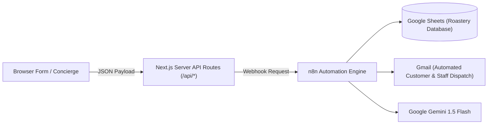

# EMBER & OAK — n8n Automation Architecture & Setup Guide

This directory contains the production-ready workflow exports for integrating **EMBER & OAK** with a self-hosted [n8n](https://n8n.io) automation instance.

---

## 1. Automation Architecture



All sensitive operations, spreadsheet appends, email dispatches, and LLM reasoning are decoupled from client-side code:
1. **Forms** submit to secure Next.js App Router API routes (`/api/reservations`, `/api/contact`, `/api/events`, `/api/faq`).
2. **Next.js API** validates inputs (preventing malformed or spam payloads) and dispatches clean webhooks to n8n via HTTPS.
3. **n8n** executes business workflows, logs transactions to Google Sheets, sends branded confirmation emails via Gmail, and notifies the roastery floor team.
4. If n8n webhooks are temporarily unreachable, the Next.js API gracefully logs submissions and provides a seamless user experience.

---

## 2. Included Workflows

| File | Purpose | Trigger Path | External Integrations |
| :--- | :--- | :--- | :--- |
| `reservation-workflow.json` | Table & cupping bookings | `POST /webhook/ember-oak-reservation` | Google Sheets, Gmail |
| `contact-workflow.json` | General & wholesale inquiries | `POST /webhook/ember-oak-contact` | Google Sheets, Gmail |
| `event-workflow.json` | Private hire & group bookings | `POST /webhook/ember-oak-event` | Google Sheets, Gmail |
| `faq-workflow.json` | AI coffee sommelier assistant | `POST /webhook/ember-oak-faq` | Gemini 1.5 Flash |

---

## 3. How to Import Into n8n

1. Log into your n8n web console (`http://localhost:5678` or your public domain).
2. Click **Workflows** in the left sidebar → Click **Add Workflow** (or `+`).
3. Click the three dots menu `...` (top right) → Select **Import from File**.
4. Choose one of the JSON files from this directory (`n8n/*.json`).
5. Configure the Google Sheets and Gmail credentials (detailed below).
6. Toggle the workflow to **Active** (top right).

---

## 4. Google Sheets & Gmail Credentials Setup

### Google Sheets Node Setup
1. Create a Google Sheet titled `Ember & Oak Roastery CRM` with 3 tabs:
   - **Reservations**: Columns: `ReservationID`, `Timestamp`, `Name`, `Email`, `Phone`, `Date`, `Time`, `Guests`, `Seating`, `SpecialRequests`, `Status`
   - **Inquiries**: Columns: `InquiryID`, `Timestamp`, `Name`, `Email`, `Phone`, `Subject`, `Message`
   - **Events**: Columns: `EnquiryID`, `Timestamp`, `ClientName`, `Email`, `Phone`, `EventType`, `Guests`, `PreferredDate`, `Message`
2. In n8n, add **Google Sheets OAuth2 API** credentials following the [n8n Google Credentials guide](https://docs.n8n.io/integrations/builtin/credentials/google/).
3. Paste your Sheet ID into the workflow node.

### Gmail Node Setup
1. In n8n, connect **Gmail OAuth2 API** credentials with `send` permission.
2. The workflow will automatically generate custom branded confirmation emails for guests and alert `tables@emberandoak.com` or `hello@emberandoak.com`.

---

## 5. Exposing Self-Hosted n8n to Vercel (Local Docker Guide)

If your n8n is running locally on Windows Docker (`localhost:5678`) and your Next.js site is deployed on Vercel:

> **Important**: Vercel serverless functions cannot reach `localhost`. Your n8n instance must have an HTTPS endpoint.

### Option A: Cloudflare Tunnel (Recommended & Free)
1. Install Cloudflare `cloudflared` on Windows:
   ```powershell
   winget install --id Cloudflare.cloudflared
   ```
2. Start an instant quick-tunnel:
   ```powershell
   cloudflared tunnel --url http://localhost:5678
   ```
3. Cloudflare will output an HTTPS address like:
   `https://random-subdomain.trycloudflare.com`
4. Set your webhook URLs in `.env.local` to this domain:
   ```env
   N8N_RESERVATION_WEBHOOK_URL=https://random-subdomain.trycloudflare.com/webhook/ember-oak-reservation
   N8N_CONTACT_WEBHOOK_URL=https://random-subdomain.trycloudflare.com/webhook/ember-oak-contact
   N8N_EVENT_WEBHOOK_URL=https://random-subdomain.trycloudflare.com/webhook/ember-oak-event
   N8N_FAQ_WEBHOOK_URL=https://random-subdomain.trycloudflare.com/webhook/ember-oak-faq
   ```

### Option B: ngrok
```powershell
ngrok http 5678
```
Copy the forwarded `https://*.ngrok-free.app` URL into your environment variables.

---

## 6. Environment Variables Required

In your root `.env.local`:
```env
# n8n Webhook Endpoints
N8N_RESERVATION_WEBHOOK_URL=https://your-n8n-domain.com/webhook/ember-oak-reservation
N8N_CONTACT_WEBHOOK_URL=https://your-n8n-domain.com/webhook/ember-oak-contact
N8N_EVENT_WEBHOOK_URL=https://your-n8n-domain.com/webhook/ember-oak-event
N8N_FAQ_WEBHOOK_URL=https://your-n8n-domain.com/webhook/ember-oak-faq

# Google Gemini API (For direct AI FAQ Concierge fallback)
GEMINI_API_KEY=your_gemini_api_key_here
```
